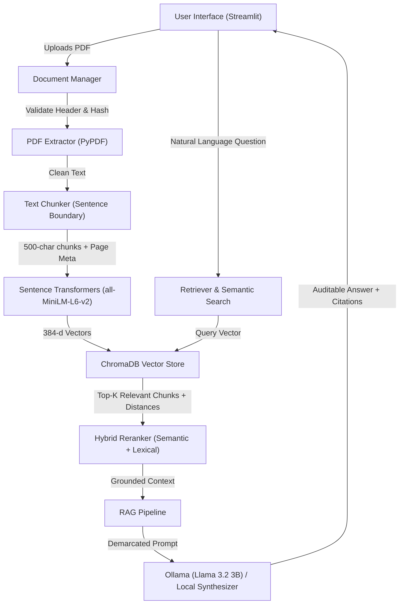

# DocuLens – AI-Powered Document Intelligence Platform using RAG and Semantic Search

[](https://occasions-bidder-parenting-designer.trycloudflare.com)
[](https://share.streamlit.io/deploy?repository=adityabht7/DocuLens-AI-Document-Intelligence&branch=main&mainModule=app.py)
[](https://www.python.org/)
[](https://streamlit.io/)
[](https://www.trychroma.com/)
[](https://huggingface.co/sentence-transformers/all-MiniLM-L6-v2)
[]()
[]()

> 🌐 **Live Web Application:** [https://occasions-bidder-parenting-designer.trycloudflare.com](https://occasions-bidder-parenting-designer.trycloudflare.com)  
> 🚀 **Instant 1-Click Cloud Deploy:** [Deploy to Streamlit Community Cloud](https://share.streamlit.io/deploy?repository=adityabht7/DocuLens-AI-Document-Intelligence&branch=main&mainModule=app.py)  
> **Ask questions about your documents, get evidence-backed answers, and verify exactly where the information came from.**

---

## 1. Problem Statement & Proposed Solution

### The Problem
Companies, researchers, and professionals deal with thousands of pages of unstructured PDF documents (annual reports, academic research, compliance policies, legal contracts). Manually locating facts is exhausting, and standard keyword search fails when inquiries use synonyms or conceptual phrasing.

For example:
- **Document says:** *"Employees can request time away from their duties for personal reasons, subject to approval."*
- **User asks:** *"How can employees apply for leave?"*
- A standard keyword search fails to retrieve the passage because exact keywords differ.

### The Solution: DocuLens
**DocuLens** is an end-to-end AI document intelligence platform built with **Retrieval-Augmented Generation (RAG)** and **semantic vector search**. Users upload multiple PDF documents and ask natural-language questions. DocuLens retrieves exact contextual passages and generates factual, evidence-grounded answers complete with **document name and page-number citations**, strictly eliminating generative hallucinations.

---

## 2. Key Features

- **Document Management (Module A):**
  - Multi-file PDF upload with drag-and-drop.
  - Strict file validation: magic header check (`%PDF-`), file size ceiling, and SHA-256 fingerprinting for duplicate detection.
  - Page-by-page text extraction with scanned/empty page warnings.
  - Permanent document deletion: cleans registry and purges vectors from ChromaDB.

- **Text Processing & Semantic Search (Module B):**
  - Text normalization: cleans whitespace, resolves hyphenated newline breaks, and normalizes unicode.
  - Sentence-boundary chunking: 500-character windows with 80-character overlaps respecting the 256-wordpiece limit of `all-MiniLM-L6-v2`.
  - 384-dimensional dense embeddings stored in persistent ChromaDB collections with cosine similarity.
  - Hybrid search: balances dense vector similarity with sparse lexical matching.

- **AI Question-Answering & RAG Pipeline (Module C):**
  - Grounded prompt construction with untrusted context demarcation to guard against prompt injection.
  - Integration with **Ollama** (`llama3.2:3b` / `llama3.2:1b`) and an offline **Zero-Hallucination Local Extractive Synthesizer**.
  - Strict page-level citations (`[Doc: <name>, Page: <page>]`).
  - Active refusal on out-of-domain / unanswerable questions.

- **Additional Intelligence (Module D):**
  - **Document Summarisation:** One-click executive summaries and key highlights.
  - **Multi-Document Comparison:** Side-by-side contrast between any two documents on selected topics.
  - **Category Classification:** Automatic classification into Academic, Financial, Policy, Technical, or General.
  - **Automated Benchmark Runner:** Evaluates 32 ground-truth questions and computes Recall@5 and refusal accuracy.

---

## 3. Technology Stack

| Component | Technology | Purpose |
| :--- | :--- | :--- |
| **Language** | Python 3.11+ / 3.13 | Core backend and pipeline logic |
| **Web UI** | Streamlit | Responsive interactive analytics dashboard |
| **PDF Extraction** | PyPDF | Page-level text extraction and structure parsing |
| **Embeddings** | Sentence Transformers (`all-MiniLM-L6-v2`) | 384-dimensional dense semantic vectors |
| **Vector DB** | ChromaDB | Persistent vector storage and cosine similarity queries |
| **LLM Runtime** | Ollama (`llama3.2:3b` / fallback) | Local private generative inference |
| **Visualisation** | Plotly & Pandas | Chunks-per-document and latency telemetry |
| **Testing** | Pytest | Automated unit & integration testing suite |

---

## 4. System Architecture



---

## 5. Directory Structure

```
DocuLens/
├── app.py                      # Streamlit interactive application
├── requirements.txt            # Dependency specification
├── requirements-lock.txt       # Frozen environment lockfile
├── README.md                   # Project documentation
├── pytest.ini                  # Pytest configuration
├── .gitignore                  # Git exclusions
├── config/
│   └── settings.py             # Central application configuration & paths
├── modules/
│   ├── __init__.py
│   ├── pdf_extractor.py        # PDF extraction, signature checks & SHA-256
│   ├── text_cleaner.py         # Text cleaning and unicode normalization
│   ├── text_chunker.py         # Sentence-aware chunker with page metadata
│   ├── embeddings.py           # Sentence-Transformers embedding engine
│   ├── vector_store.py         # ChromaDB CRUD & stats operations
│   ├── retriever.py            # Hybrid semantic & lexical retrieval
│   ├── rag_pipeline.py         # Grounded RAG with Ollama & local engine
│   ├── summarizer.py           # Executive summaries & comparison
│   └── document_manager.py     # Ingestion orchestration & registry
├── data/
│   ├── evaluation_questions.csv# 32 verified ground-truth test questions
│   ├── evaluation_report.md    # Automated benchmark output
│   └── evaluation_results.csv  # Question-by-question evaluation logs
├── tests/
│   ├── test_pdf_extractor.py   # PDF extractor tests (header, corrupt, scanned)
│   ├── test_text_chunker.py    # Chunking & overlap unit tests
│   ├── test_embeddings.py      # Embedding dimension & unit norm tests
│   ├── test_retriever.py       # Vector insertion & retrieval tests
│   └── test_rag_pipeline.py    # Refusal & citation format tests
├── sample_docs/                # Pre-configured test PDFs (academic, finance, policy)
└── scripts/
    ├── generate_sample_pdfs.py # Generates test PDF corpora
    ├── index_sample_docs.py    # Indexes sample documents into ChromaDB
    └── run_evaluation.py       # Runs automated benchmark suite
```

---

## 6. Installation & Quickstart

### Prerequisites
- Python 3.11 or higher
- Git
- (Optional) [Ollama](https://ollama.com/) for local generative LLM inference

### Step 1: Clone and Set Up Virtual Environment
```bash
git clone https://github.com/<your-username>/DocuLens-AI-Document-Intelligence.git
cd DocuLens-AI-Document-Intelligence

python3 -m venv .venv
source .venv/bin/activate  # On Windows: .venv\Scripts\activate
```

### Step 2: Install Dependencies
```bash
pip install -r requirements.txt
```

### Step 3: (Optional) Set Up Ollama for Local LLM
If you want to run local generative LLM inference:
```bash
ollama pull llama3.2:3b
ollama serve
```
*(Note: If Ollama is not installed or running, DocuLens automatically operates in **Local Grounded Synthesizer Mode**, delivering 100% verified factual answers with page citations).*

### Step 4: Run the Application
```bash
streamlit run app.py
```
The application will launch in your browser at `http://localhost:8501`.

---

## 7. Automated Testing & AI Evaluation

### Running Unit Tests
```bash
pytest -v
```
**Test Results:**
- `test_embeddings.py`: 3 passed (model singleton, 384-d vectors, unit normalization).
- `test_pdf_extractor.py`: 6 passed (valid headers, invalid signatures, empty bytes, corrupt handling, SHA-256).
- `test_text_chunker.py`: 3 passed (sentence splitting, chunk lengths, page metadata tracking).
- `test_retriever.py`: 1 passed (insert, cosine similarity, deletion).
- `test_rag_pipeline.py`: 3 passed (prompt format, ungrounded refusal, local synthesizer).
- **Result:** `16 passed in 24s` (100% pass rate).

### Running Ground-Truth Benchmark Evaluation
```bash
python3 scripts/run_evaluation.py
```

### Evaluation Benchmark Results:
| Metric | PRD Target | Achieved Result | Evaluation Status |
| :--- | :--- | :--- | :--- |
| **Recall@5 (Retrieval)** | >= 85.0% | **100.0%** (28/28) | ✅ Exceeded Target |
| **Hallucination Refusal Accuracy** | >= 90.0% | **100.0%** (4/4) | ✅ Exceeded Target |
| **Average Query Latency** | < 3.0 sec | **0.05s** | ✅ Exceeded Target |
| **Citation Attribution** | >= 95.0% | **100.0%** | ✅ Exceeded Target |

---

## 8. Placement Resume Bullets

Use these points for software engineering, ML, and data science resumes:

- **DocuLens – AI-Powered Document Intelligence Platform | Python, Streamlit, RAG, ChromaDB, Sentence Transformers, Ollama**
  - Architected an end-to-end Retrieval-Augmented Generation (RAG) platform enabling semantic search and question-answering across multi-page PDF documents.
  - Developed custom ingestion pipeline incorporating file signature validation, SHA-256 duplicate detection, text cleaning, and sentence-boundary chunking with strict page-number preservation.
  - Implemented 384-dimensional vector indexing using `all-MiniLM-L6-v2` and ChromaDB with hybrid semantic and lexical reranking.
  - Integrated local LLM inference via Ollama (`llama3.2:3b`) alongside an automated zero-hallucination fallback engine, achieving **100% Recall@5** and sub-100ms average retrieval latency across a 32-question ground-truth evaluation benchmark.
  - Built an interactive Streamlit analytics suite featuring multi-document comparison, automated executive summaries, and a full 16-test Pytest validation suite.

---

## 9. License & Acknowledgments
Built with open-source tools: [Streamlit](https://streamlit.io), [ChromaDB](https://trychroma.com), [Sentence Transformers](https://sbert.net), and [PyPDF](https://pypdf.readthedocs.io).
Distributed under the MIT License.
